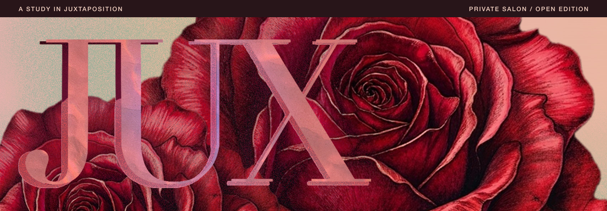

We’re a creative studio in Philadelphia. We build romantic worlds through photography, styling, and creative direction. In one of our portraits, a figure in leopard print sits among gilded paintings. The room tells as much of the story as the clothes.

MJ ([@villagealchemist](https://github.com/villagealchemist)) sets the technical direction for JUX and builds the website and tools we use to publish our editorials.

[Explore the work](https://www.juxnow.com/) or [follow JUX on Instagram](https://www.instagram.com/juxnow/).

For collaborations and editorial commissions, [write to Tone](mailto:tone@juxnow.com).
